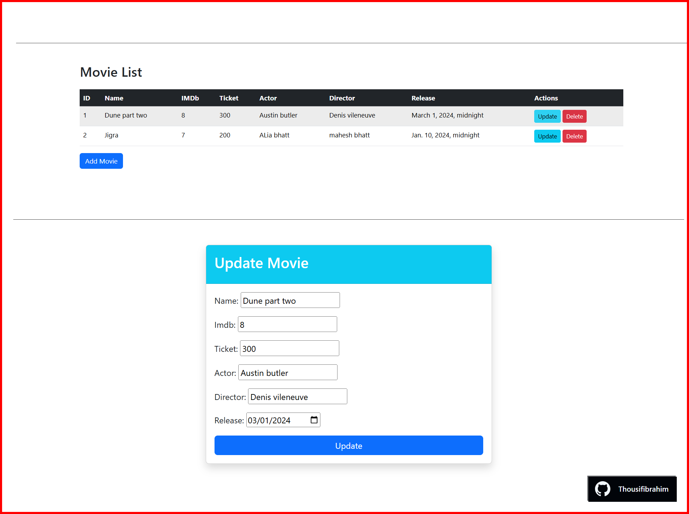

<!-- Tech stack badges (icon shields) -->
[]()
[]()
[]()
[]()
[]()
[]()
[]()
[]()

<!-- Language composition (provided percentages) -->
[]()
[]()

## DjangoModel Form

A small, educational Django project that demonstrates basic Create, Read, Update, Delete (CRUD) operations for managing movies using Django models, ModelForms, and views.

This repository is intended for learning and reference — it shows how to:
- Create new records with Django ModelForm
- List and view saved records
- Edit existing records
- Delete records

---

### Demo



---

### Features
- Add new movies to the database
- View a list of all movies
- Update existing movie details
- Delete movies from the database

---

### Tech stack
- Backend: Django (Python)
- Database: SQLite (default for Django development)
- Frontend: Django templates (HTML + Django Template Language)

---

### Prerequisites
- Python 3.8+ (3.10/3.11 recommended)
- Git (to clone the repo)
- Optional: virtualenv or venv (highly recommended)

---

### Quickstart

```bash
1. Clone the repository

2. Create and activate a virtual environment

- macOS / Linux
```bash
python -m venv venv
source venv/bin/activate
```

- Windows (PowerShell)
```powershell
python -m venv venv
.\venv\Scripts\Activate.ps1
```

- Windows (cmd.exe)
```cmd
python -m venv venv
venv\Scripts\activate
```

3. Install dependencies

If a `requirements.txt` exists:
```bash
pip install -r requirements.txt
```
Otherwise install Django directly:
```bash
pip install django
```

4. Apply migrations
```bash
python manage.py migrate
```

5. (Optional) Create a superuser to access the admin
```bash
python manage.py createsuperuser
```

6. Run the development server
```bash
python manage.py runserver 8000
```

Open http://localhost:8000 in your browser to view the app.

---

## Typical URLs (adjust if your project uses different patterns)
- List movies: `/` or `/movies/`
- Add a movie: `/movies/add/`
- Edit a movie: `/movies/<id>/edit/`
- Delete a movie: `/movies/<id>/delete/`
- Django admin: `/admin/`

(If your URL names differ, check `urls.py` for the exact paths.)

---

### Project structure (example)
- manage.py
- <app_name>/
  - models.py        — Movie model(s)
  - forms.py         — ModelForm(s) for movie
  - views.py         — CRUD views
  - templates/       — HTML templates
  - urls.py          — app routing

---

### Development notes
- Use ModelForm to keep form handling simple and DRY.
- Keep business logic in models/managers where appropriate and views thin.
- Add unit tests in `<app_name>/tests.py` for forms and views as you expand functionality.

---

### Running tests
If tests exist:
```bash
python manage.py test
```
